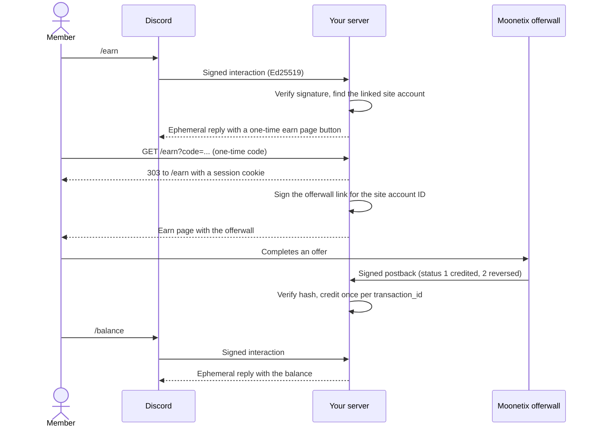

# Discord Rewards Bot

**Give your Discord members a private way to earn your server coins by completing offers, within Discord's rules.**

[](https://github.com/moonetix/discord-rewards-bot/actions/workflows/ci.yml)
[](LICENSE)
[](https://docs.moonetix.com/postbacks)
[](https://moonetix.com/register?from=github-discord-rewards-bot)
[](https://moonetix.com/academy/integrations/discord-bot-offerwall)
[](https://moonetix.com/industries/discord)

A Discord app built on the HTTP Interactions endpoint, with `/earn` and `/balance`, a private earn page on your site with the [Moonetix](https://moonetix.com) offerwall, and a postback handler that credits coins. Moonetix is an affiliate network: your members earn your own currency by completing offers, and you earn per completed offer.

> **Get your App ID and keys: sign up free at https://moonetix.com/register?from=github-discord-rewards-bot**

## Design choices

1. **Discord IDs stay with you.** The offerwall only sees your own site account ID. The bot never builds a link from a Discord ID and never posts a signed link in Discord.
2. **No gateway, no intents.** Discord sends commands to your HTTPS endpoint, signed with Ed25519. The app cannot read messages, so it cannot reward chat, joins or invites even by mistake.
3. **Runs as is.** Node 22, no npm packages, SQLite built into Node, and 26 tests with a local Ed25519 key pair and real Moonetix postback vectors.

## How it fits together



## Quick start

You need Node.js 22.13 or later, an app in the [Discord Developer Portal](https://discord.com/developers/applications), an https host, and a Moonetix app.

```bash
git clone https://github.com/moonetix/discord-rewards-bot.git
cd discord-rewards-bot
cp .env.example .env          # fill in your Discord and Moonetix values
npm run register-commands     # once: registers /earn and /balance
npm start                     # listens on PORT (default 3000)
```

Then:

1. In the Discord Developer Portal, set Interactions Endpoint URL to `https://YOUR_HOST/interactions`. Discord sends a signed PING and a request with a bad signature to check it. This server answers both correctly.
2. In the Moonetix dashboard, open Offerwalls, your offerwall, Integration, and copy the App ID and link hash salt into `.env`.
3. On the Postback page, copy the postback secret key into `.env` and save this postback URL:

```
https://YOUR_HOST/moonetix/postback?user={user_id}&tx={transaction_id}&event={event_id}&status={status}&reward={reward}&payout={payout}&offer={offer_name}&hash={hash}
```

4. Link a test member. On your real site this is sign-up plus Discord OAuth2 linking. For local testing:

```bash
npm run link-account -- --discord YOUR_DISCORD_USER_ID --name Ana --age-16-plus
```

| Variable | Required | Default | What it is |
| --- | --- | --- | --- |
| `DISCORD_PUBLIC_KEY` | yes | none | 64 hex characters from General Information. Verifies every interaction. |
| `SITE_URL` | yes | none | Public address of your site. The earn page is `SITE_URL/earn`. Cookies are `Secure` when it starts with `https://`. |
| `MOONETIX_APP_ID` | yes | none | App ID from the Integration section. |
| `MOONETIX_LINK_SALT` | yes | none | Link hash salt from the Integration section. |
| `MOONETIX_POSTBACK_KEY` | yes | none | Postback secret key from the Postback page. |
| `DISCORD_APPLICATION_ID`, `DISCORD_BOT_TOKEN` | for `register-commands` | none | Only read by `scripts/register-commands.js`. |
| `DISCORD_GUILD_ID` | no | empty | Registers the commands in one server, where they show up right away. Empty means global. |
| `LINK_ACCOUNT_URL` | no | `SITE_URL/account` | Your page where members link Discord. |
| `EARN_COOLDOWN_SECONDS` | no | `30` | Time between two `/earn` uses per member. |
| `PORT` | no | `3000` | HTTP port. |
| `DATABASE_PATH` | no | `./data.sqlite` | SQLite file. |
| `CURRENCY_NAME` | no | `Coins` | Currency name in replies and on the earn page. |

## How it works

1. Members have an account on your site and link Discord to it with OAuth2. The link is stored in `discord_links`. One Discord account per site account.
2. Discord posts every command to `POST /interactions`. The server verifies `X-Signature-Ed25519` over the timestamp and raw body with your public key, rejects old timestamps, and answers 401 when the check fails.
3. `/earn` looks up the linked account. Not linked: a button to your account page. Under 16: no link. Otherwise an ephemeral reply, which only that member sees, with a button to `SITE_URL/earn?code=...`. The code is random, works once and expires in 10 minutes. It holds no Discord ID and no offerwall link.
4. The earn page swaps the code for an HttpOnly session cookie, redirects to `/earn`, and builds the signed offerwall link there, on the server, from the site account ID.
5. Moonetix calls `GET /moonetix/postback`. The server checks the hash first, credits on status 1 once per `transaction_id`, takes the credited amount back on status 2, and answers 200 after the change is stored.
6. There are no DMs. Members see new rewards with `/balance` and in the Recent rewards list on the earn page.

| Path | Purpose |
| --- | --- |
| `src/discord.js` | Ed25519 signature check |
| `src/commands.js` | `/earn` and `/balance` |
| `src/earn-page.js` | Earn page HTML |
| `src/moonetix.js` | Signed link, postback hash, exact amounts |
| `src/postback.js` | Postback handler |
| `src/store.js` | SQLite accounts, links, sessions, transactions |
| `src/server.js` | HTTP routes |
| `scripts/register-commands.js` | Registers the commands with Discord |
| `scripts/link-account.js` | Links a test account for local testing |

## Security notes

- Secrets come from environment variables only. The interactions endpoint needs just the public key; the bot token is only used by the register script.
- Every interaction is checked with `crypto.verify` and Ed25519 before the body is parsed.
- The offerwall `user_id` is your site account ID. Discord's Developer Policy does not let you disclose API Data, such as a Discord user ID, to monetization services.
- Signed offerwall links are only built on the earn page for the signed-in member. They never appear in Discord. Earn codes and session tokens are stored as SHA-256 hashes.
- The earn page sends a Content-Security-Policy that only allows frames from `wall.moonetix.com`, plus `no-store` and `no-referrer`.
- The postback hash is checked with a constant-time comparison before anything else. Tampered or wrongly signed postbacks get 403.
- `transaction_id` is the primary key of the transactions table, so a retry cannot credit twice. A reversal subtracts the stored credited amount, only for a transaction credited to the same account.
- Amounts are stored as integers in millionths of a coin, so decimal rewards add up exactly.

## Discord rules this app follows

- Coins only for completed offers. Never for joining, inviting, boosting, bumping, reviews, messages or reactions. The app has no gateway connection and cannot see any of those.
- Links only on request, in an ephemeral reply. No offers or links in channels, and no DMs about offers.
- Members must be 16 or older, with a parent's permission under 18. Check age on your site.
- Keep offer-earned coins away from slots, coin flips and other chance games.

Read the current [Discord Developer Policy](https://support-dev.discord.com/hc/en-us/articles/8563934450327-Discord-Developer-Policy) and [Developer Terms of Service](https://support-dev.discord.com/hc/en-us/articles/8562894815383-Discord-Developer-Terms-of-Service) before launch.

## Test it locally

```bash
npm test
```

The tests need no Discord app and no network. They:

- create a local Ed25519 key pair, then check that a valid signature passes and a changed body, timestamp or signature, another key, missing headers and old timestamps fail;
- start the server on a random port with an in-memory database and send signed interactions: PING gets PONG, bad signatures get 401, `/earn` is ephemeral with a link button that holds no Discord ID and no offerwall link, the cooldown works, and unlinked or under-16 members get no link;
- follow the button: the code signs in once, the earn page holds the signed link for the site account, and a reused code, a missing cookie and a forged cookie all fail;
- replay real Moonetix postbacks (`test/fixtures/moonetix-vectors.json`): credit, retry, decimals, reversal, repeated reversal, uncredited `test_` reversal, unknown users, and tampered or wrongly signed postbacks, with `/balance` checked after each step.

With `npm start` running, [postback-tester](https://github.com/moonetix/postback-tester) checks the postback route from the outside. It signs requests exactly like Moonetix and covers retries, reversals, forged and unsigned postbacks and five parallel copies of one credit. Use a site account ID from `npm run link-account` so the credits land on a real account:

```bash
export MOONETIX_POSTBACK_KEY=your-postback-secret-key   # same value as in .env
npx github:moonetix/postback-tester --preset moonetix \
  'http://localhost:3000/moonetix/postback?user={user_id}&tx={transaction_id}&event={event_id}&status={status}&reward={reward}&payout={payout}&offer={offer_name}&hash={hash}' --user 1
```

## Test it with Moonetix

1. Link your own Discord account to a test site account and run `/earn` in your server. Only you see the reply.
2. Open the earn page. In the dashboard, open Offerwalls, your offerwall, Integration, and use Check a link to compare Test a link for your site account ID with the link on the page.
3. Click Send a test postback for that account ID with status 1. This server credits test postbacks for real account IDs, so `/balance` goes up once. A retry of the same transaction changes nothing.
4. A status 2 test gets a new `test_` transaction ID that was never credited, so the server answers 200 and changes nothing. The Postback page has the same test sender.
5. Open the offerwall from a normal home or mobile connection. VPNs, proxies, Tor and data center networks see a block page.
6. Before launch, remove the test rewards from your test account.

The offerwall iframe only loads on https pages of the website you registered for your Moonetix app. The earn page also has a plain link that opens the offerwall in a new tab.

## Common problems

| What you see | Why, and the fix |
| --- | --- |
| `node: .env: not found` | `npm start` and the scripts read `.env` from the repo root. Run `cp .env.example .env`. |
| `Missing environment variables: ...` or `DISCORD_PUBLIC_KEY must be 64 hex characters` | A required value is empty or is not the public key (the bot token and client secret are not). |
| Developer Portal: "interactions endpoint url could not be verified" | Discord could not reach `https://YOUR_HOST/interactions`, or got 401 `invalid request signature` for its valid PING because the public key belongs to another app. |
| `Set DISCORD_APPLICATION_ID and DISCORD_BOT_TOKEN first.` or `Discord answered 401` | `register-commands` needs the application ID and a current bot token. |
| `/earn` says "Link Discord to your account on our site first" | The member has no row in `discord_links`. Locally, run `npm run link-account`. |
| Earn page shows "Link expired" | The button code works once and for 10 minutes. Run `/earn` again. |
| Postback answers `403 invalid hash` | Wrong `MOONETIX_POSTBACK_KEY`, or a proxy changed a signed value. |

## Learn more

- Guide: [How to Add an Offerwall to a Discord Bot](https://moonetix.com/academy/integrations/discord-bot-offerwall)
- Guide: [Offerwalls for Discord bots compared](https://moonetix.com/academy/monetization/best-offerwall-for-discord-bots)
- Moonetix for Discord: [moonetix.com/industries/discord](https://moonetix.com/industries/discord)
- Docs: [Postbacks](https://docs.moonetix.com/postbacks), [Offerwall link](https://docs.moonetix.com/offerwall-link), [Credits and reversals](https://docs.moonetix.com/credits-and-reversals), [Testing](https://docs.moonetix.com/testing)
- Free tools: [Offerwall link builder](https://moonetix.com/tools/offerwall-link-builder) and [Postback hash checker](https://moonetix.com/tools/postback-hash-checker)

## Get started

**Get your App ID and keys: sign up free at https://moonetix.com/register?from=github-discord-rewards-bot**

Every publisher application is reviewed by hand. Once you are approved, add your site as an app, set your coin name and rate, and paste the keys into `.env`.

## More Moonetix examples

- **Start here:** [awesome-offerwalls](https://github.com/moonetix/awesome-offerwalls), [offerwall-postback-handlers](https://github.com/moonetix/offerwall-postback-handlers)
- **SDKs:** [moonetix-android-sdk](https://github.com/moonetix/moonetix-android-sdk), [moonetix-ios-sdk](https://github.com/moonetix/moonetix-ios-sdk), [moonetix-flutter](https://github.com/moonetix/moonetix-flutter), [moonetix-react-native](https://github.com/moonetix/moonetix-react-native), [moonetix-unity](https://github.com/moonetix/moonetix-unity)
- **Web and backends:** [offerwall-nextjs-starter](https://github.com/moonetix/offerwall-nextjs-starter), [offerwall-react-vite](https://github.com/moonetix/offerwall-react-vite), [offerwall-vue-nuxt](https://github.com/moonetix/offerwall-vue-nuxt), [offerwall-express](https://github.com/moonetix/offerwall-express), [offerwall-laravel](https://github.com/moonetix/offerwall-laravel), [offerwall-django](https://github.com/moonetix/offerwall-django), [offerwall-firebase-functions](https://github.com/moonetix/offerwall-firebase-functions), [offerwall-supabase](https://github.com/moonetix/offerwall-supabase), [rewards-site-starter](https://github.com/moonetix/rewards-site-starter), [moonetix-offerwall-wordpress](https://github.com/moonetix/moonetix-offerwall-wordpress)
- **Apps and games:** [offerwall-flutter-example](https://github.com/moonetix/offerwall-flutter-example), [offerwall-react-native-example](https://github.com/moonetix/offerwall-react-native-example), [offerwall-unity-example](https://github.com/moonetix/offerwall-unity-example), [offerwall-godot](https://github.com/moonetix/offerwall-godot), [offerwall-html5-game](https://github.com/moonetix/offerwall-html5-game)
- **Communities and desktop:** [telegram-mini-app-offerwall](https://github.com/moonetix/telegram-mini-app-offerwall), [offerwall-chrome-extension](https://github.com/moonetix/offerwall-chrome-extension), [offerwall-electron](https://github.com/moonetix/offerwall-electron)
- **Tools and data:** [postback-tester](https://github.com/moonetix/postback-tester), [signup-guard](https://github.com/moonetix/signup-guard), [datacenter-ip-ranges](https://github.com/moonetix/datacenter-ip-ranges), [reward-economy-kit](https://github.com/moonetix/reward-economy-kit), [referral-engine](https://github.com/moonetix/referral-engine), [gamification-kit](https://github.com/moonetix/gamification-kit), [offerwall-fraud-playbook](https://github.com/moonetix/offerwall-fraud-playbook), [affiliate-postback-macros](https://github.com/moonetix/affiliate-postback-macros), [country-tiers](https://github.com/moonetix/country-tiers)

## License

MIT. See [LICENSE](LICENSE).
